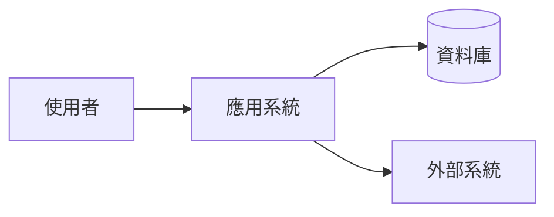
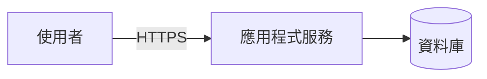

# [主題]規劃與設計文件

> 文件版本：`0.1.0`
> 文件狀態：規劃中
> 最後更新日期：`YYYY-MM-DD`
> 文件位置：`_Documents/[專案名稱]/02-Planning/[主題]-規劃設計.md`

---

## 1. 文件資訊

| 項目 | 內容 |
|---|---|
| 專案名稱 | `[專案名稱]` |
| 系統代號 | `[系統代號]` |
| 文件負責人 | `[姓名或部門]` |
| 原始碼位置 | `[Repository URL]` |
| 專案管理位置 | `[專案管理 URL]` |
| 關聯系統文件 | `[相對路徑或無]` |

### 修訂紀錄

| 版本 | 日期 | 修改者 | 修改內容 |
|---|---|---|---|
| 0.1.0 | YYYY-MM-DD | `[姓名]` | 建立初始版本 |

---

## 2. 專案背景與目標

### 背景說明

`[說明目前情況、既有問題及建立系統的原因]`

### 專案目標

- `[目標一]`
- `[目標二]`
- `[目標三]`

### 非目標

本階段不處理：

- `[非目標一]`
- `[非目標二]`

---

## 3. 規劃範圍

### 使用者角色

| 角色 | 說明 | 主要權限 |
|---|---|---|
| `[角色]` | `[角色說明]` | `[主要權限]` |

### 功能範圍

| 功能模組 | 功能說明 | 優先等級 | 狀態 |
|---|---|---|---|
| `[功能模組]` | `[功能說明]` | 高／中／低 | 規劃中 |

### 系統限制

- `[部署環境限制]`
- `[技術或版本限制]`
- `[外部系統限制]`
- `[法規或資安限制]`

---

## 4. 非功能需求

| 項目 | 需求 |
|---|---|
| 系統服務時間 | `[服務時間]` |
| 預估使用人數 | `[人數]` |
| 回應時間 | `[目標回應時間]` |
| 可用性 | `[可用性需求]` |
| RTO | `[待確認或實際目標]` |
| RPO | `[待確認或實際目標]` |
| 相容性 | `[瀏覽器、裝置或作業系統]` |

---

## 5. 技術選型

| 類別 | 技術 | 版本 | 用途 |
|---|---|---|---|
| 前端 | `[技術]` | `[版本]` | `[用途]` |
| 後端 | `[技術]` | `[版本]` | `[用途]` |
| 資料庫 | `[技術]` | `[版本]` | `[用途]` |
| 部署環境 | `[技術]` | `[版本]` | `[用途]` |
| 其他 | `[技術]` | `[版本]` | `[用途]` |

### 選型說明

#### `[技術名稱]`

- 採用原因：`[原因]`
- 主要用途：`[用途]`
- 限制或注意事項：`[限制]`

---

## 6. 系統架構

### 架構概觀



> 請依實際架構修改或移除此圖。

### 系統元件

| 元件 | 責任 | 相依項目 |
|---|---|---|
| `[元件名稱]` | `[主要責任]` | `[相依元件或服務]` |

### 程式目錄

```text
src/
├─ [專案或模組]
├─ [專案或模組]
└─ [其他已確認專案或模組]
```

### 架構原則

- `[原則一]`
- `[原則二]`
- `[原則三]`

---

## 7. 資料設計

### 資料庫資訊

| 項目 | 內容 |
|---|---|
| DBMS | `[資料庫類型與版本]` |
| 資料庫名稱 | `[名稱]` |
| 字元排序規則 | `[Collation]` |
| 時區原則 | `[UTC／台北時間／其他]` |
| 版本管理方式 | `[Migration 或 SQL Script]` |

### 主要資料表

| 資料表 | 用途 | 主要關聯 |
|---|---|---|
| `[資料表名稱]` | `[用途]` | `[關聯資料表]` |

### 資料處理原則

- `[交易原則]`
- `[索引原則]`
- `[軟刪除或歷程紀錄原則]`
- `[資料保存與清除原則]`

---

## 8. API 與系統介面

### API 原則

- API 路徑與命名保持一致。
- 使用適當的 HTTP Method。
- 日期時間採用統一格式。
- 錯誤回應包含可追蹤的識別資訊。
- 驗證、授權及輸入驗證由伺服器端執行。

### API 清單

| Method | 路徑 | 用途 | 權限 |
|---|---|---|---|
| GET | `/api/[resource]` | `[用途]` | `[權限]` |
| POST | `/api/[resource]` | `[用途]` | `[權限]` |

### 外部系統介面

| 系統 | 用途 | 通訊方式 | 驗證方式 |
|---|---|---|---|
| `[外部系統]` | `[用途]` | REST／SFTP／其他 | `[驗證方式]` |

---

## 9. 身分驗證與授權

### 驗證方式

- 驗證機制：`[Cookie／JWT／OIDC／Windows Authentication／其他]`
- 登入有效時間：`[時間]`
- 是否支援多因素驗證：是／否
- 是否支援單一登入：是／否

### 授權方式

- 授權模型：`[角色／權限／Policy]`
- 權限檢查位置：`[說明]`
- 管理者權限範圍：`[說明]`

### 權限清單

| 權限代碼 | 說明 |
|---|---|
| `[permission.code]` | `[權限說明]` |

---

## 10. 資訊安全

> 以下是規劃階段的建議安全基線，並非既有系統事實。請依已確認需求保留、調整或標示 `[待確認]`。

- [ ] 正式環境是否強制使用 HTTPS：[待確認]
- [ ] 機密資訊是否禁止寫入原始碼：[待確認]
- [ ] SQL 查詢是否使用參數化：[待確認]
- [ ] 輸入資料是否由伺服器端驗證：[待確認]
- [ ] 敏感資料是否需要加密或遮罩：[待確認]
- [ ] 上傳檔案是否限制類型及大小：[待確認]
- [ ] 重要操作是否需要稽核紀錄：[待確認]
- [ ] 日誌是否禁止記錄密碼、完整 Token 或其他機密資訊：[待確認]

### 特殊資安需求

- `[需求一]`
- `[需求二]`

---

## 11. 例外、日誌與監控

### 例外處理

- 使用統一的例外處理方式。
- 不將系統內部錯誤細節回傳給使用者。
- 錯誤回應提供 Trace ID 或相同用途的識別資訊。
- 避免在不同程式層重複記錄相同例外。

### 日誌內容

- 時間。
- 日誌等級。
- 系統環境。
- Trace ID。
- 使用者識別。
- 請求路徑。
- 執行結果。
- 執行時間。
- 例外資訊。

### 監控項目

| 項目 | 告警條件 |
|---|---|
| 系統可用性 | `[條件]` |
| 錯誤率 | `[條件]` |
| 回應時間 | `[條件]` |
| CPU 與記憶體 | `[條件]` |
| 背景工作 | `[條件]` |

---

## 12. 部署與環境

### 環境分類

| 環境 | 用途 | 資料性質 |
|---|---|---|
| Development | 開發 | 模擬或開發資料 |
| Test | 測試 | 測試資料 |
| Staging | 上線前驗證 | 測試或去識別化資料 |
| Production | 正式服務 | 正式資料 |

### 部署架構



> 請依實際部署架構修改或移除此圖。

### 部署流程

1. 執行建置；測試工作另依後續測試規劃執行。
2. 建立部署套件。
3. 備份現有版本及必要資料。
4. 執行資料庫變更。
5. 部署應用程式。
6. 依後續驗證或測試工作執行健康檢查與主要功能驗證。
7. 完成部署紀錄。

### 回復方式

1. `[停止或隔離異常版本]`
2. `[還原前一版本]`
3. `[處理資料庫變更]`
4. `[重新驗證系統]`

---

## 13. 後續測試工作預告

規劃／設計階段預設不展開測試案例、測試執行方式或測試驗收內容。後續進入開發或測試階段時，應另行建立測試工作規劃，並依實際 Repository 現況、Acceptance Criteria 與驗證需求定義測試範圍、方法、時機及驗收證據。

### 開發階段與 Exit Criteria

> Planning 階段定義 Phase 的目標、邊界與離開條件即可；詳細 Work Unit 可在進入開發時依 Repository 現況建立與調整，避免過早將實作步驟寫死。

| Phase | Objective | Boundary／主要範圍 | Exit Criteria |
|---|---|---|---|
| Phase 1 | `[階段目標]` | `[本階段涵蓋與不涵蓋內容]` | `[可驗證的完成條件，例如必要 AC 定義完成、無未處理 Major Finding、Human Gate 通過]` |

### Work Unit 切分原則

- Work Unit 應以可獨立實作、驗證與 Review 為優先。
- 不以 Agent 單次可完成的最大工作量為切分標準。
- 實作前應重新確認 Repository 現況；若與規劃有差異，可 Re-plan 後再調整 Work Unit。
- Phase 完成以 Exit Criteria 與 Evidence 為依據，不以「原訂 Task 已執行」作為唯一判定。

---

## 14. 風險與待確認事項

### 風險

| 風險 | 影響 | 因應方式 |
|---|---|---|
| `[風險內容]` | 高／中／低 | `[因應方式]` |

### 待確認事項

| 編號 | 問題 | 負責人 | 狀態 |
|---|---|---|---|
| Q-001 | `[待確認問題]` | `[姓名或部門]` | 待確認 |

---

## 15. 上線檢查表

### 程式與設定

- [ ] 正式版本已確認。
- [ ] 正式環境設定已確認。
- [ ] 機密資訊未寫入原始碼。
- [ ] API 或介面文件已更新。

### 資料庫

- [ ] 資料庫已備份。
- [ ] 資料庫變更方案已確認；實際驗證另依後續測試規劃執行。
- [ ] 回復方式已準備。

### 資安

- [ ] HTTPS 正常。
- [ ] 權限需求與授權設計已確認；實際驗證另依後續測試規劃執行。
- [ ] 敏感資料未出現在日誌。
- [ ] 必要的資安檢查已完成。

### 維運

- [ ] 健康檢查正常。
- [ ] 日誌正常寫入。
- [ ] 監控及告警正常。
- [ ] 備份作業正常。
- [ ] 維運聯絡窗口已確認。

---

## 附錄

### 相關文件

- `[需求規格文件]`
- `[API 文件]`
- `[資料庫規格]`
- `[操作手冊]`
- `[維運手冊]`

### 名詞定義

| 名詞 | 說明 |
|---|---|
| `[名詞]` | `[說明]` |
